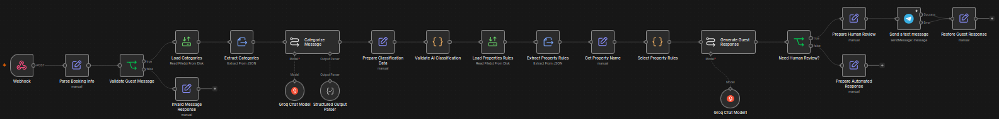

# AI Guest Messaging Assistant

An AI-powered guest messaging automation prototype for short-term rental (STR) operations.

Built with n8n, Groq AI, Python, and webhooks.

## Overview

This project demonstrates how property managers can automate routine guest inquiries while identifying requests that need human attention.

The assistant receives guest messages, classifies their intent, retrieves property-specific information, and generates responses using AI.

Requests requiring staff assistance are flagged for review and generate Telegram notifications.

## Features

- Receive guest messages through an n8n webhook.
- Validate incoming guest messages.
- Classify guest requests using Groq AI.
- Validate AI classifications against a JSON taxonomy using Python.
- Load property-specific information from a JSON configuration file.
- Generate dynamic guest responses based on property rules.
- Route requests requiring human attention.
- Notify a property manager through Telegram.
- Return structured JSON responses to the calling application.
- Continue processing if Telegram notification delivery fails.

## Technologies

- **n8n:** Workflow orchestration
- **Groq AI:** Guest message classification and response generation
- **Python:** Classification validation and API testing
- **Webhooks:** Receive guest requests and return responses
- **Telegram Bot API:** Manager notifications
- **JSON:** Classification taxonomy and property configuration
- **Docker Compose:** Local n8n environment
- **Git:** Version control

## Workflow Screenshot



## Workflow Overview
```text
Guest Message
    |
    v
Webhook
    |
    v
Validate Message
    |
    v
AI Classification
    |
    v
Python Classification Validation
    |
    v
Load Property Information
    |
    v
Generate AI Response
    |
    v
Human Review Required?
    |
    +-- No --> Return AI Response
    |
    +-- Yes --> Notify Manager via Telegram
                       |
                       v
                 Return AI Acknowledgment
```

## Example Scenarios

### Routine Guest Inquiry

Guest:
"What is the Wi-Fi password?"

The workflow retrieves the property's fictional Wi-Fi information and generates a response.

Expected status: `ready`

### Maintenance Request

Guest:
"The air conditioner isn't working."

The workflow identifies a maintenance issue, generates an acknowledgment, and sends a Telegram notification.

Expected status: `needs_human_review`

### Missing Property Information

Guest:
"Does the property have a swimming pool?"

The assistant explains that the information requires confirmation rather than inventing an answer.

## Project Structure

config/
    categories.json
    properties.json

workflows/
    guest-messaging.json

README.md

## Setup Instructions

### Requirements

- Docker and Docker Compose
- n8n with Python Code node execution available
- Groq API credentials
- Telegram bot credentials
- Python 3 with the `requests` library (for testing)

### 1. Import the Workflow

Import `workflows/guest-messaging.json` into n8n.

### 2. Configure Property Files

The workflow reads two JSON configuration files:

- `config/categories.json`
- `config/properties.json`

These files must be accessible inside the n8n container at:

- `/home/node/.n8n-files/str-ai-guest-messaging/categories.json`
- `/home/node/.n8n-files/str-ai-guest-messaging/properties.json`

For a Docker Compose installation, add a read-only bind mount to the n8n service:

```yaml
volumes:
  - n8n-data:/home/node/.n8n
  - /path/to/str-ai-guest-messaging/config:/home/node/.n8n-files/str-ai-guest-messaging:ro
```

Replace `/path/to/str-ai-guest-messaging/config` with the actual directory containing the configuration files.

Preserve the existing volumes and other settings in your Docker Compose configuration.

### 3. Configure Credentials

Inside n8n:

- Connect the Groq Chat Model nodes to your Groq credentials.
- Connect the Telegram notification node to your Telegram bot credentials.
- Replace `YOUR_TELEGRAM_CHAT_ID` with your own recipient Chat ID.

Never commit API tokens or real guest credentials.

### 4. Test the Workflow

Use the n8n Webhook node's test URL.

Send a POST request containing JSON similar to:

```json
{
  "reservation_id": "RES-1001",
  "guest_name": "Maria",
  "property_name": "Sunrise Villa",
  "message": "What time is check-in?"
}
```

The workflow should return a JSON response containing:

- `status`
- `guest_response`
- `requires_attention`

Requests needing staff assistance should also trigger a Telegram notification.

## Current Limitations

- This is a portfolio prototype, not a production-ready hospitality system.
- Property information and guest details are fictional.
- Messages are received through a test webhook rather than directly from Airbnb or Vrbo.
- AI classifications and responses may occasionally be inaccurate.
- Human-review requests are flagged and notified, but final approval happens outside the workflow.
- Failed Telegram notifications do not currently trigger automatic retries or separate failure alerts.
- Guest identity verification and secure delivery of real access credentials are not implemented.

## Development Status

## Test Results

The following scenarios were tested successfully in the
local n8n environment.

| Test Scenario | Expected Behavior | Result |
|---|---|---|
| Normal check-in inquiry | Generate automated response | PASS |
| Early check-in request | Route to human review and notify manager | PASS |
| Invalid AI classification | Force human review | PASS |
| Telegram notification failure | Continue processing and return guest response | PASS |
| Empty guest message | Return validation error | PASS |
| Fictional Wi-Fi inquiry | Provide property-specific Wi-Fi information | PASS |

## Development Status

**Status: Completed Portfolio Prototype**

The core AI Guest Messaging Assistant has been implemented,
tested locally, and documented.

The project demonstrates:

- AI-powered guest message classification
- Python-based classification validation
- Property-specific response generation
- Automated and human-review routing
- Telegram manager notifications
- Basic error handling and input validation
- Git version control

This is a functional portfolio demonstration using
fictional property data and simulated guest messages.

Production Airbnb/Vrbo integration is not included.